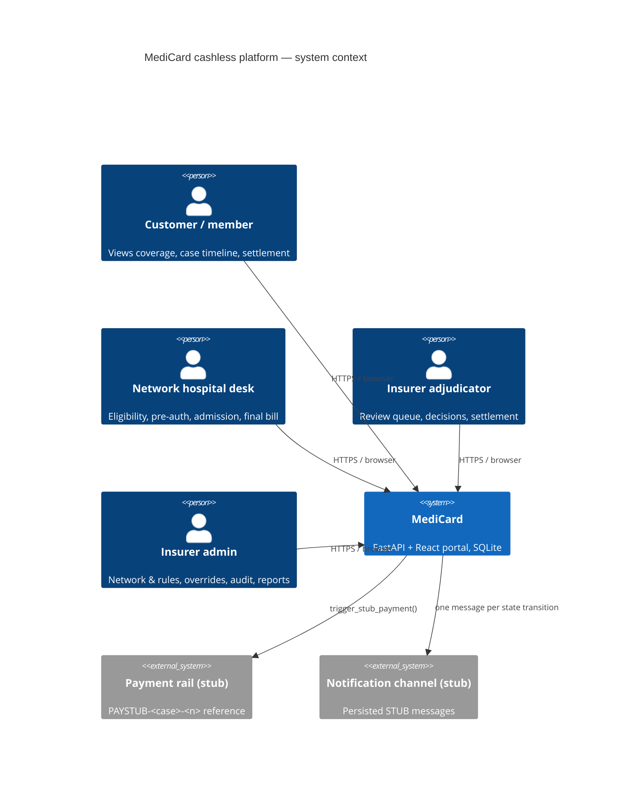
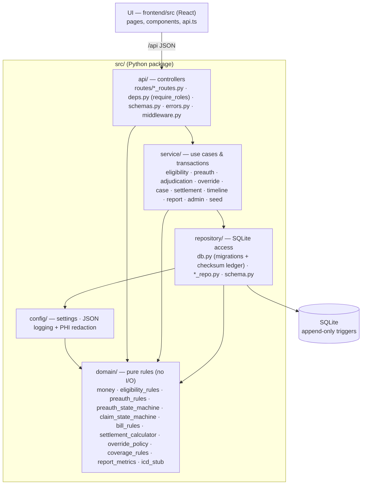
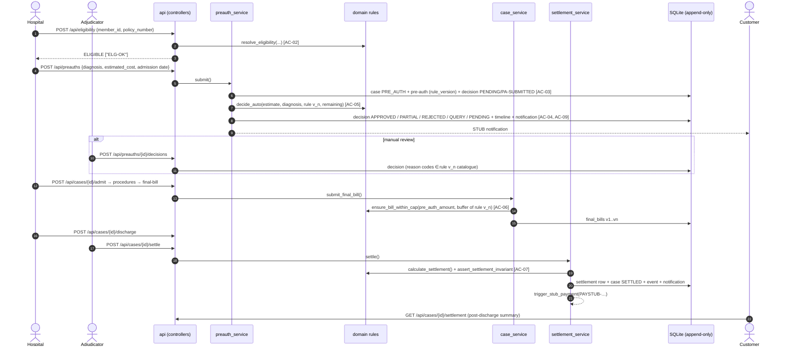
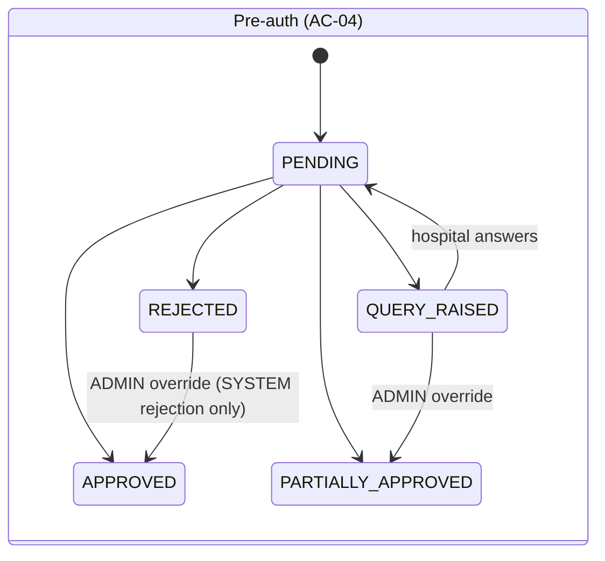
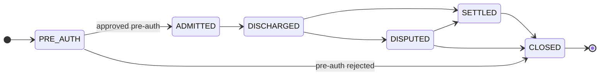
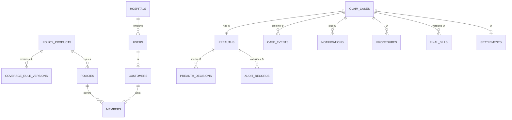

# MediCard — Architecture

## 1. System context (C4 level 1)

## 2. Layered structure (controllers / services / repositories / domain)

| Layer | Package | Responsibility | Enforced by |
|---|---|---|---|
| Controllers | `src/api` | Auth boundary (`require_roles`), request validation (Money rejects float), error envelope, correlation ids | `role-boundary-check.sh`, `tests/architecture/test_controllers_guarded.py` |
| Services | `src/service` | Load facts, call domain rules, one transaction per use case, ownership checks (hospital sees own cases), timeline + notifications | import-linter "no fastapi in services" |
| Repositories | `src/repository` | Parameterised SQL, money as TEXT, append-only tables | `test_append_only.py`, DB triggers |
| Config | `src/config` | `MEDICARD_*` settings, JSON formatter, PHI filter | `phi-redaction-check.sh` |
| Domain | `src/domain` | Pure, deterministic business rules and state machines | import-linter "domain is pure", `test_layering.py` |

Import rule: a layer may import only layers below it (`lint-imports` contract
`src.main > src.api > src.service > src.repository > src.config > src.domain`).

## 3. Eligibility → settlement flow (sequence)

`rule v_n` is the coverage-rule version **recorded on the pre-auth**. A rule published later never
changes the cap or settlement of an existing case (ST-R1, fix loop FL-001).

## 4. State machines

Any other edge raises `InvalidClaimStateException` (409). A SETTLED case is mutation-locked at
three levels: `ensure_case_mutable` in the domain, the service guards, and a DB trigger
(`trg_claim_cases_settled_locked`).

## 5. Data model (append-only tables marked ⊕)

## 6. Cross-cutting

| Concern | Mechanism |
|---|---|
| Money (NFR-01) | `Decimal` + `money.quantize` (HALF_UP, 0.01); TEXT columns; API `Money` type rejects JSON floats |
| PHI (NFR-03) | Event-style logs with ids only; `PhiRedactionFilter`; hook; log-capture tests |
| Logs (NFR-06) | `JsonFormatter` (UTC), `X-Correlation-ID` middleware, `case_id` context var, uvicorn routed through JSON too |
| Auth (NFR-04) | HMAC-signed bearer token (stdlib), PBKDF2 passwords, `require_roles` at the controller, ownership → 404 in services |
| Migrations (NFR-05) | `migrations/NNNN_*.sql` + SHA-256 ledger → `MigrationTamperedError`; hook blocks editing existing files |
| Health (NFR-07) | `GET /health`, tested to answer within 1 s of startup |
