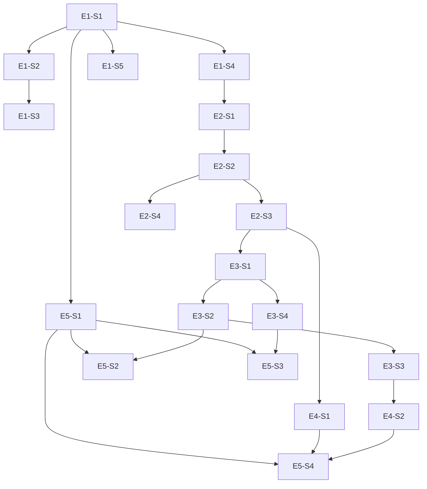

# Dependency Graph

Groups execute in order A → B → C → D → E; one harness sprint per group.

| Group | Stories | Sprint contract |
|---|---|---|
| A | E1-S1, E1-S2, E1-S3, E1-S4, E1-S5 | `sprint-contracts/group-A.json` |
| B | E2-S1, E2-S2, E2-S3, E2-S4 | `sprint-contracts/group-B.json` |
| C | E3-S1, E3-S2, E3-S3, E3-S4 | `sprint-contracts/group-C.json` |
| D | E4-S1, E4-S2 | `sprint-contracts/group-D.json` |
| E | E5-S1, E5-S2, E5-S3, E5-S4 | `sprint-contracts/group-E.json` |
